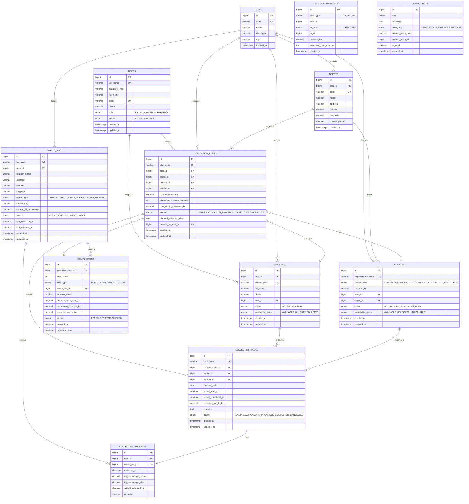

# Entity Relationship (ER) Diagram & Relational Schema Guide

This document presents the normalized relational database architecture for the **Smart Waste Management and Collection Optimization System** (`waste_management_db`).

---

## 1. Mermaid Entity-Relationship Diagram

---

## 2. Relational Normalization Analysis

### First Normal Form (1NF)
- All columns contain atomic, non-decomposable values (e.g. single strings, single decimals).
- No repeating groups or arrays stored in single attributes.
- Each table defines a strict primary key.

### Second Normal Form (2NF)
- The schema is in 1NF.
- Every non-key attribute is fully functionally dependent on the primary key (no partial dependencies on composite keys).
- Route stops decompose individual tour waypoints into child records linked to parent collection plans.

### Third Normal Form (3NF / Boyce-Codd Normal Form)
- The schema is in 2NF.
- There are no transitive dependencies: non-key attributes depend only on the primary key, not on other non-key attributes.
- Distances are maintained in a dedicated lookup matrix table `location_distances`, decoupled from bin metadata.

---

## 3. Referential Integrity & Deletion Rules
- **Safe Soft Deletions**: Inactive bins, workers, and vehicles are flagged with `status = 'INACTIVE'` or `status = 'MAINTENANCE'` rather than `DELETE FROM ...`. This strictly preserves historical audit trails for past collection routes, fuel records, and worker tonnage statistics.
- **Foreign Key Constraints**: Foreign keys are enforced at the database engine level with InnoDB (`ON DELETE RESTRICT` on core references and `ON DELETE CASCADE` on tightly coupled child stops).
